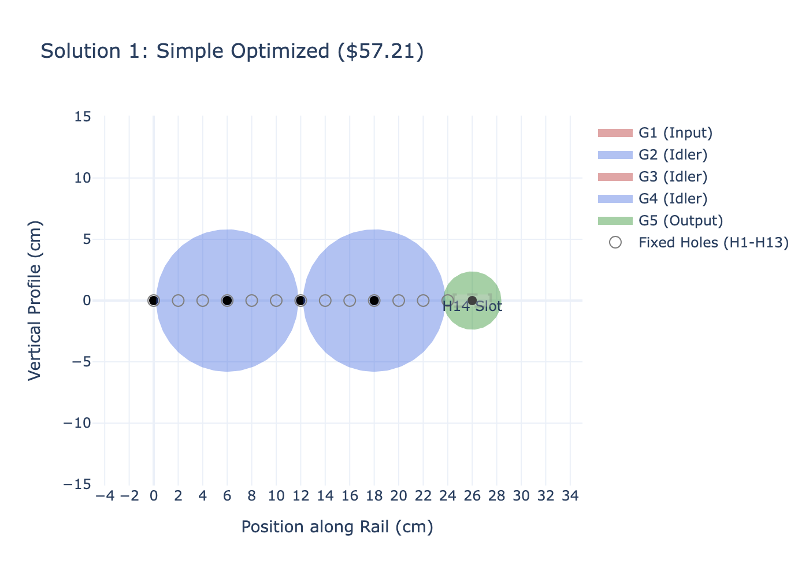
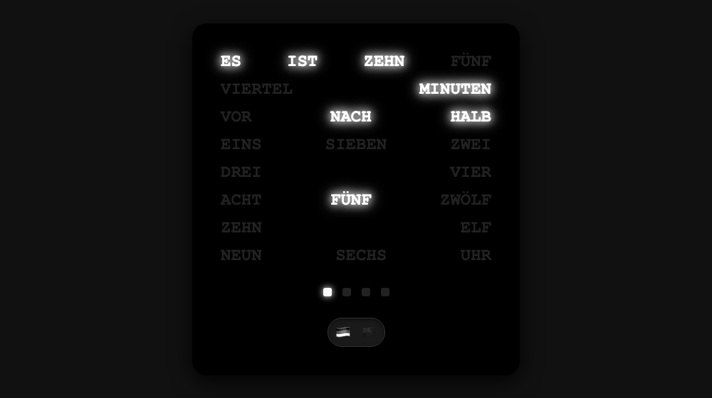
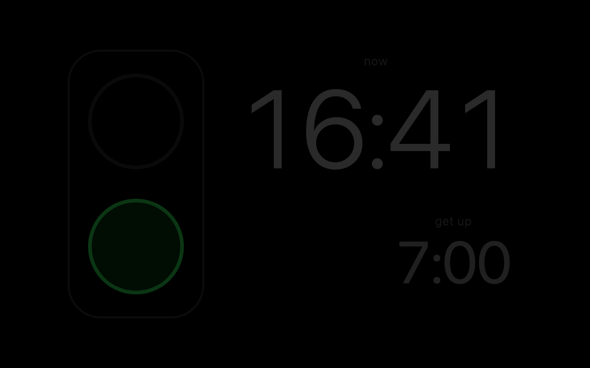
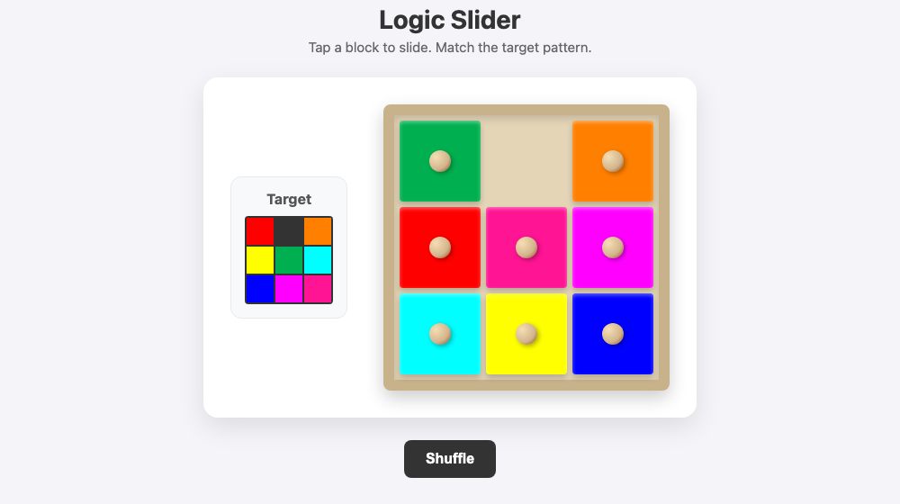

### Mechatronics engineer and educator, building with AI

I've spent years making machines work and explaining how they work. These days I mostly do that with AI in the loop: I prototype quickly, then verify thoroughly. My background is mechatronics systems integration, a PhD in engineering design and teaching engineers to code. I'm looking for people who want to turn the "AI + physical world" combination into products.

&nbsp;

#### Selected work

<table>
<tr>
<td width="50%" valign="top">

 <b><a href="https://github.com/jensbri/SynthesisChallenge">SynthesisChallenge</a></b>
 Can generative AI do engineering <i>synthesis</i>? An LLM proposes gear trains, and Python optimisation (differential evolution, dual annealing) checks them. The chat's "optimal" $49 design actually costs $91.
 <code>Python</code> <code>optimisation</code> <code>LLM evaluation</code>
</td>
<td width="50%" valign="top">

 <b><a href="https://jensbri.github.io/wortuhr/">Wortuhr</a></b> · <a href="https://github.com/jensbri/wortuhr">code</a>
 A German/English word clock rebuilt from a single photo of the physical one. I made it in about 20 minutes on a phone, with an AI chat as the only dev tool.
 <code>HTML/JS</code> <code>GitHub Pages</code> <code>AI-assisted</code>
</td>
</tr>
<tr>
<td width="50%" valign="top">

 <b><a href="https://jensbri.github.io/letmesleep/">Wake Light</a></b> · <a href="https://github.com/jensbri/letmesleep">code</a>
 An "OK to wake" clock for kids that turns an old phone into an OLED-black bedside traffic light. It works offline and is installable as a PWA.
 <code>PWA</code> <code>offline-first</code> <code>kid-proof UX</code>
</td>
<td width="50%" valign="top">

 <b><a href="https://jensbri.github.io/Puzzling8oo9/">Logic Slider</a></b> · <a href="https://github.com/jensbri/Puzzling8oo9">code</a>
 A sliding-block colour puzzle: tap to slide, then match the target. It runs as a PWA on any phone.
 <code>JavaScript</code> <code>PWA</code> <code>game</code>
</td>
</tr>
</table>

#### Teaching & community

- **Machine learning:** contributor to The Carpentries' [*Introduction to Machine Learning with scikit-learn*](https://github.com/carpentries-incubator/machine-learning-novice-sklearn) lesson
- **Research Bazaar:** workshops on Python, Git, LaTeX and Quarto for researchers ([slides](https://jensbri.github.io/QuartoSlides/))

&nbsp;

Interested in building something at the edge of AI and hardware? Open an issue on any repo, or find me via the links in my CV.
